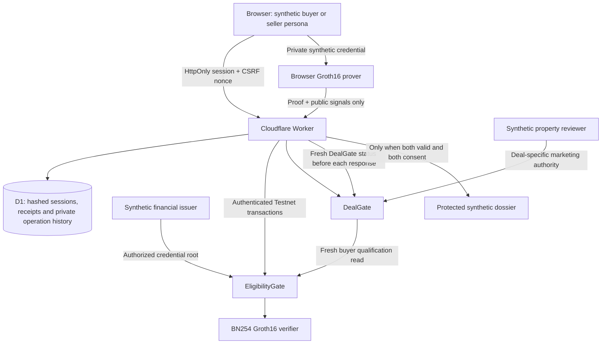

# Architecture and trust boundaries

This document describes the current implementation. The README and pitch use the separate [production target architecture](PRODUCTION_ARCHITECTURE.md).

| Information | Location / disclosure |
|---|---|
| Certified balance, holder secret, credential salt and membership path | Private synthetic issuer bundle in Worker secrets; selected witness returned only to the session's buyer/judge persona |
| Proof generation | Browser Web Worker; private witness is not submitted to Stellar |
| Threshold, root, deal ID, recipient binding, nullifier and proof | Public Stellar Testnet |
| Seller authority | Issuer-authenticated claim for a random salted property commitment; no address or source documents onchain |
| Dossier and fictional identity/address | Worker-controlled API response after fresh qualification and consent checks; never static assets |
| Session authentication | Random 256-bit HttpOnly cookie; SHA-256 token digest stored in D1; same-origin mutation plus CSRF nonce |
| Signing keys | Disposable Testnet accounts in Worker secrets; the demo service signs for the selected synthetic persona |

## Scope and expiry

Every session creates a new immutable deal policy in both contracts. Shared signer transactions are serialized with a D1 compare-and-set lease. Request bodies are bounded; API responses use `private, no-store`. The browser interface never authorizes disclosure by itself.

The buyer gate checks the exact current five-minute ledger epoch. A proof's qualification expires at the end of that epoch, and a holder/deal nullifier can be consumed only once. Use a fresh demo deal after expiry. Session/deal lifetime is 20 minutes. The synthetic issuer batch lasts 30 days and must be renewed before expiry or after a Testnet reset.

The public demo intentionally allows a visitor to act as all personas in their own synthetic session. It does not authenticate a real buyer, seller, bank or document reviewer. Production needs institution onboarding, user-controlled signing, durable credential renewal, an audited setup/verifier and independent security review.

Revocation and withdrawal prevent subsequent authorized responses. Data already disclosed to a recipient cannot be recalled from their memory, screenshots or device.

## License boundary

Original business logic is subject to the repository's rights-reserved notice and evaluation permission. Reused code and dependencies retain their own licenses. In particular, snarkjs, circomlib, circomlibjs, circom2 and ffjavascript declare GPL-3.0. The root notice does not make those components pay-only or remove any applicable copyleft obligations. Commercial packaging needs a component-level licensing review or replacement/separate licensing of incompatible components. See `docs/THIRD_PARTY.md`.

### Demo operation history

`GET /api/activity` reads only the authenticated session’s latest 100 structured operation records. Testnet writes record simulation, signing/submission, pending confirmation and final outcome. `POST /api/circuit-result` accepts only the underfunded/expired scenario names with CSRF protection; it stores a browser-reported rejection, never an onchain receipt or private witness. Logs are cleaned after one day. Browser-only progress is transient; server-recorded steps and reported rejections survive refresh while the session remains valid.

The interface recovers from an expired/missing session by clearing protected content and showing **Start new demo session**. Session/deal and seller-authority deadlines are shown separately from the shorter buyer-proof window. Five minutes is a conservative MVP policy, not a Stellar requirement; changing it needs consistent circuit epoch, contract and credential changes.
