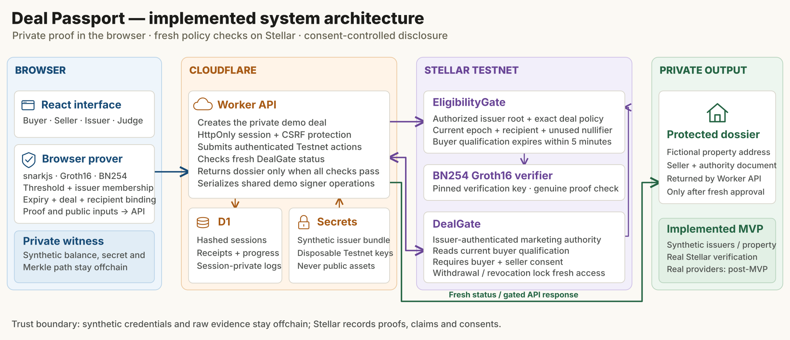

# Production target architecture

This is the intended system after production engineering and provider onboarding. It is based on the original build specification's product scope, credential model and technical architecture, with the later decisions on real verification and non-GPL components. Implementation of these production changes remains post-MVP.

[Full-size SVG](architecture-assets/dealpassport-system.svg) · [PNG](architecture-assets/dealpassport-system.png)

## Main blocks

| Block | Responsibility |
|---|---|
| React interface | Buyer, seller and approved issuer portals, user wallet authorization, private credential handling and the deal room. |
| Cloudflare backend | Workers API and provider adapters. Buyer verification validates financial credentials and manages renewal/revocation. Seller verification combines identity, property evidence and a reviewed marketing mandate. Deal access evaluates the deal rules and both consents before returning private content. D1 stores application records and audit metadata. R2 holds private documents with encryption, tenant isolation and controlled key access. |
| External verification services | Identity provider, authorized financial evidence source, property registry evidence and a qualified reviewer. Each provides evidence for a specific claim. Approved issuers authenticate credentials after the relevant checks. |
| Private ZK proofs | Local WebAssembly proving on the user's device. A Groth16/BN254 relation proves a trusted credential meets the stored deal threshold, is current and belongs to the authorized holder, without disclosing the amount. The plan uses Rust/Arkworks to replace the current proving stack. |
| Stellar Mainnet / Soroban | Issuer authorization, credential roots and revocation, Groth16 proof verification, buyer/seller qualification and deal consent. Proofs and minimal public commitments stay onchain. Raw identity, bank evidence, property addresses and documents stay offchain. |

The Cloudflare subareas are logical responsibilities within one backend, not a commitment to separately deployed microservices. The ZK block is a separate technical responsibility, while its private proving runtime executes locally. The backend supplies policy and credential-delivery coordination without receiving the holder secret.

## Evidence and authorization flow

1. Identity, financial and property checks supply evidence to the relevant backend workflow. A seller's identity check alone cannot establish authority to market a property. A registry entry alone may not establish the seller's mandate.
2. An approved issuer signs or commits to a credential. Its root/status and permitted role become verifiable through Soroban. The holder receives the private credential and controls the proving secret.
3. The local prover binds the financial qualification to the deal, recipient and validity policy. The user authorizes the resulting onchain action with their own wallet.
4. Soroban verifies the proof, accepted issuers, seller claim, current validity and mutual consent. The backend reads current contract state before authorizing each private document response.
5. Production renewal allows a fresh credential/proof for the same deal under a versioned expiry/replay policy. Withdrawal and revocation block later responses. They cannot recall a document already received.

## Planned stack

The architecture uses one technology per role. The choices prioritize integration effort, the Portugal-first workflow and the existing Groth16/BN254 design. They are planning decisions, not a measured claim that each product is universally fastest or cheapest. Implementation and provider onboarding remain post-MVP.

| Area | Selected technology | Integration requirement |
|---|---|---|
| Identity | [Didit](https://docs.didit.me/) | Hosted identity workflows reduce custom onboarding work. Verify callbacks, supported users/documents, privacy/retention and commercial terms. |
| Funds evidence | [Reclaim](https://docs.reclaimprotocol.org/) | Use verifiable evidence from a supported financial source. Validate the exact portal and claim before relying on it, then bind that evidence to an approved issuer's credential. Reclaim does not itself guarantee bank coverage or certify available funds. |
| Property records | [Predial Online](https://www.predialonline.pt/PredialOnline/) | Obtain official Portuguese registry/certificate evidence for a qualified reviewer to match identity, property rights and the marketing mandate. This is a document/reviewer workflow, not a claimed automated seller-authority API. See [prior research](REAL_PROPERTY_VERIFICATION_OPTIONS.md). |
| Credential infrastructure | [ACTA](https://acta.build/) | Implement issuance and anchoring/revocation while preserving Deal Passport's credential commitments and deal policy. |
| Proving stack | Rust [Arkworks Groth16](https://github.com/arkworks-rs/groth16) compiled for a local WebAssembly flow | Keep constraint synthesis and proving in one Rust stack. Demonstrate browser, serialization and Soroban compatibility, review pinned licenses and audit the replacement. See [migration plan](PROVER_MIGRATION_OPTIONS.md). |

The original specification also listed Fairblock as an optional future integration. It has no defined responsibility in the selected architecture, so it is not shown as a required dependency. The design includes no escrow, tokenized property or title transfer.

## Production engineering boundary

The target requires reviewed circuits/contracts and setup, a complete license-compatible proving stack, managed issuer keys and rotation, user-controlled signing, renewable credentials, durable indexing and transaction handling, tenant isolation, encrypted evidence storage, retention/deletion controls, monitoring and recovery. Provider onboarding and independent security review precede Mainnet launch. These are implementation requirements rather than completed certifications.

Reference checked 26 October 2026: [Stellar ZK documentation](https://developers.stellar.org/docs/build/apps/zk) confirms the BN254 primitives and need for application proving systems and verifier contracts. Provider links above support only their stated role, not end-to-end Deal Passport compatibility.
